<!-- Profile README for github.com/shineyrbl-byte -->

  <picture>
    <source media="(prefers-color-scheme: dark)" srcset="https://raw.githubusercontent.com/shineyrbl-byte/shineyrbl-byte/main/assets/profile-banner.svg"/>
    <source media="(prefers-color-scheme: light)" srcset="https://raw.githubusercontent.com/shineyrbl-byte/shineyrbl-byte/main/assets/profile-banner-light.svg"/>
    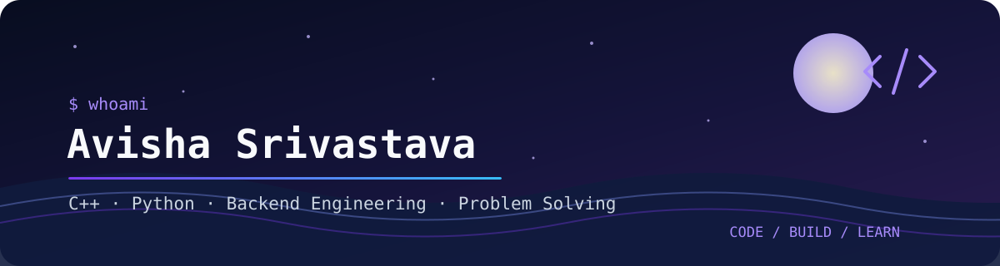
  </picture>

<h1 align="center">Hi, I'm Avisha 👋</h1>

  <b>Software Engineering | C++ · Python · Backend & Systems</b> 
  BITS Pilani, Goa Campus · 2024–2028

  <picture>
    <source media="(prefers-color-scheme: dark)" srcset="https://raw.githubusercontent.com/shineyrbl-byte/shineyrbl-byte/main/assets/typing-dark.svg"/>
    <source media="(prefers-color-scheme: light)" srcset="https://raw.githubusercontent.com/shineyrbl-byte/shineyrbl-byte/main/assets/typing-light.svg"/>
    
  </picture>

  

<!-- NOW-BUILDING:START -->

  🚧 <b>Now building:</b> <a href="https://github.com/shineyrbl-byte/shelflife">shelflife</a>: Expiry tracking and rescue bundles for small cafés and grocers

<!-- NOW-BUILDING:END -->

---

### `whoami`

I'm an undergraduate at **BITS Pilani, Goa Campus** who enjoys building software from the ground up and understanding how it works under the hood. My current focus is **C++ backend and systems programming**—networked servers, concurrency, and data structures—alongside Python-based applications.

- 🧩 Interested in C++, DSA, backend engineering, and core computer science
- 🔧 I enjoy building practical projects, from TCP servers to developer tools
- 🏁 I ship fast at hackathons: 20+ builds in Oct–Nov 2026 alone, from AR lenses to quantum compilers
- 🌱 Currently building C++ systems projects, practising DSA, and strengthening my foundations in OS, computer networks, DBMS, and system design

### `skills --list`

  

| Area | Tools & concepts |
|---|---|
| **Languages** | C++, Python, TypeScript, JavaScript, Kotlin, SQL |
| **Core CS** | Data Structures & Algorithms, OOP, DBMS |
| **Backend & Systems** | POSIX sockets, TCP/IP, HTTP/1.1, multithreading, Flask, FastAPI, CMake |
| **Web** | React, Next.js, Node.js, HTML, CSS |
| **Tools** | Git, GitHub, Docker, VS Code |

### `ls ~/featured-projects`

<a href="https://github.com/shineyrbl-byte/TitanHTTP">
  <picture>
      <source media="(prefers-color-scheme: dark)" srcset="https://raw.githubusercontent.com/shineyrbl-byte/shineyrbl-byte/main/profile/pin-TitanHTTP-dark.svg"/>
      <source media="(prefers-color-scheme: light)" srcset="https://raw.githubusercontent.com/shineyrbl-byte/shineyrbl-byte/main/profile/pin-TitanHTTP-light.svg"/>
      
    </picture>
</a>
<a href="https://github.com/shineyrbl-byte/mini-redis">
  <picture>
      <source media="(prefers-color-scheme: dark)" srcset="https://raw.githubusercontent.com/shineyrbl-byte/shineyrbl-byte/main/profile/pin-mini-redis-dark.svg"/>
      <source media="(prefers-color-scheme: light)" srcset="https://raw.githubusercontent.com/shineyrbl-byte/shineyrbl-byte/main/profile/pin-mini-redis-light.svg"/>
      
    </picture>
</a>
<a href="https://github.com/shineyrbl-byte/last-minute-life-saver">
  <picture>
      <source media="(prefers-color-scheme: dark)" srcset="https://raw.githubusercontent.com/shineyrbl-byte/shineyrbl-byte/main/profile/pin-last-minute-life-saver-dark.svg"/>
      <source media="(prefers-color-scheme: light)" srcset="https://raw.githubusercontent.com/shineyrbl-byte/shineyrbl-byte/main/profile/pin-last-minute-life-saver-light.svg"/>
      
    </picture>
</a>
<a href="https://github.com/shineyrbl-byte/AI-Text-Summarizer">
  <picture>
      <source media="(prefers-color-scheme: dark)" srcset="https://raw.githubusercontent.com/shineyrbl-byte/shineyrbl-byte/main/profile/pin-AI-Text-Summarizer-dark.svg"/>
      <source media="(prefers-color-scheme: light)" srcset="https://raw.githubusercontent.com/shineyrbl-byte/shineyrbl-byte/main/profile/pin-AI-Text-Summarizer-light.svg"/>
      
    </picture>
</a>
<a href="https://github.com/shineyrbl-byte/mini-dbms">
  <picture>
      <source media="(prefers-color-scheme: dark)" srcset="https://raw.githubusercontent.com/shineyrbl-byte/shineyrbl-byte/main/profile/pin-mini-dbms-dark.svg"/>
      <source media="(prefers-color-scheme: light)" srcset="https://raw.githubusercontent.com/shineyrbl-byte/shineyrbl-byte/main/profile/pin-mini-dbms-light.svg"/>
      
    </picture>
</a>

<b>What I built in each project</b>

| Project | What I built | Stack |
|---|---|---|
| [**TitanHTTP**](https://github.com/shineyrbl-byte/TitanHTTP) | HTTP/1.1 server built from scratch with POSIX sockets, request parsing, static-file serving, error handling, and a fixed-size worker thread pool. Tested with curl, netcat, and concurrent clients. | C++, POSIX sockets, threads |
| [**Mini Redis**](https://github.com/shineyrbl-byte/mini-redis) | Multithreaded TCP key-value store with Redis-style commands, lazy TTL expiry, mutex-protected storage, and disk persistence. Local PING benchmarks in the project README report ~62.3K req/s sequentially and ~107.8K req/s across 10 clients. | C++17, TCP, mutexes, file I/O |
| [**Last-Minute Life Saver**](https://github.com/shineyrbl-byte/last-minute-life-saver) | Student productivity planner with a C++ REST backend, task-priority and risk-analysis logic, Gemini-powered study plans, and productivity analytics. | C++, React, CMake, Gemini API |
| **RSA Security Lab** *(private course project)* | Interactive project exploring RSA key generation, encryption/decryption, and selected attacks on deliberately weak or controlled examples. | C++, cryptography |
| [**Mini DBMS**](https://github.com/shineyrbl-byte/mini-dbms) *(in progress)* | Relational database engine from scratch: typed columns, schemas, and tables that validate rows on insert. Next up: storage, indexing, and a query layer. | C++, CMake |
| [**AI Text Summarizer**](https://github.com/shineyrbl-byte/AI-Text-Summarizer) | React and FastAPI application that summarizes text and uploaded PDFs using a Hugging Face DistilBART model. | Python, FastAPI, React, Transformers |

<b>Systems project architecture previews</b>

**TitanHTTP**

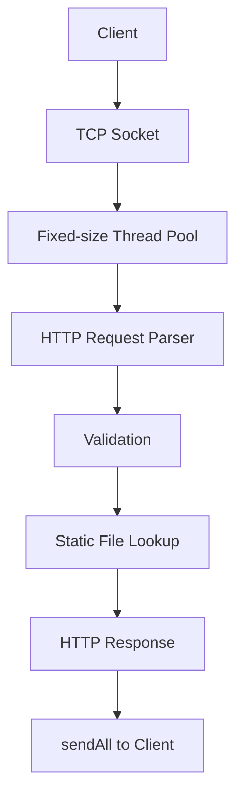

**Mini Redis**

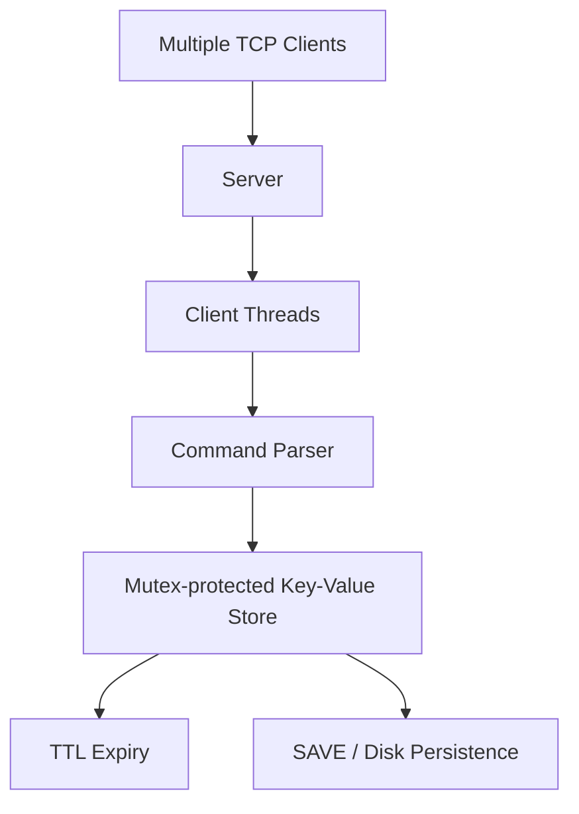

### `hackathons --recent`

| Project | What it does | Event | Links |
|---|---|---|---|
| **Distributed Quantum Compiler** | Splits Qiskit circuits across linked QPUs with teleportation, gate packing, and wire cutting, plus a resource-aware scheduler. Verified on real IBM quantum hardware. | QFF 2026 | private repo |
| [**Seed & Spread**](https://github.com/shineyrbl-byte/seed-and-spread) | Issue-seeded code-graph repo maps that help small on-device models (Gemma 4) localize bugs. | Gemma 4 Paper Track | [repo](https://github.com/shineyrbl-byte/seed-and-spread) |
| [**Scar Tissue**](https://github.com/shineyrbl-byte/scar-tissue) | Forge app + Rovo agent that turns forgotten postmortems into just-in-time warnings on Jira issues. | Codegeist 2026 | [demo](https://youtu.be/YXnuIGSu_dk) |
| [**Duely**](https://github.com/shineyrbl-byte/duely) | AI get-paid copilot for freelancers: turns messy chats into PayPal invoices and chases late payments with an approval-first agent. | PayPal AI Hackathon | [live](https://duely-ten-iota.vercel.app) · [demo](https://youtu.be/fmJgOGCpJZk) |
| [**Moss & Moon**](https://github.com/shineyrbl-byte/moss-and-moon) | Full café platform: drink builder, group orders, payments, accounts, AI barista, and a staff dashboard with analytics. | Personal build | [live](https://moss-and-moon.up.railway.app) |
| [**SayMath**](https://github.com/shineyrbl-byte/saymath) | Turns typed equations into clear, explorable speech in English and Hindi. Works offline. | AccessED Hacks 2026 | [live](https://shineyrbl-byte.github.io/saymath/) · [demo](https://youtu.be/OQ8i_HQ8HNc) |
| [**Lab Logger**](https://github.com/shineyrbl-byte/lab-logger) | AR Lens for Snap Spectacles that logs lab bench sensor readings into a floating table and live graphs. | Learn AR with SPECS | [demo](https://youtu.be/4U_Zpr5aqFk) |

<table>
  <tr>
    <td align="center" width="33%"><a href="https://moss-and-moon.up.railway.app">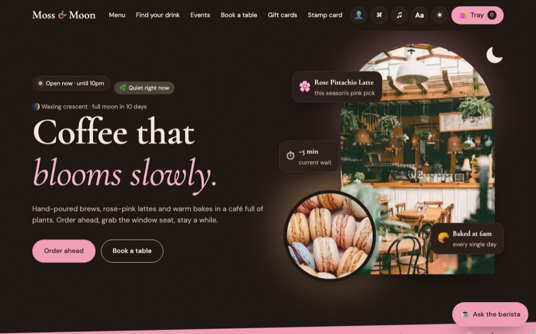</a> <b>Moss &amp; Moon</b> · café platform</td>
    <td align="center" width="33%"><a href="https://duely-ten-iota.vercel.app">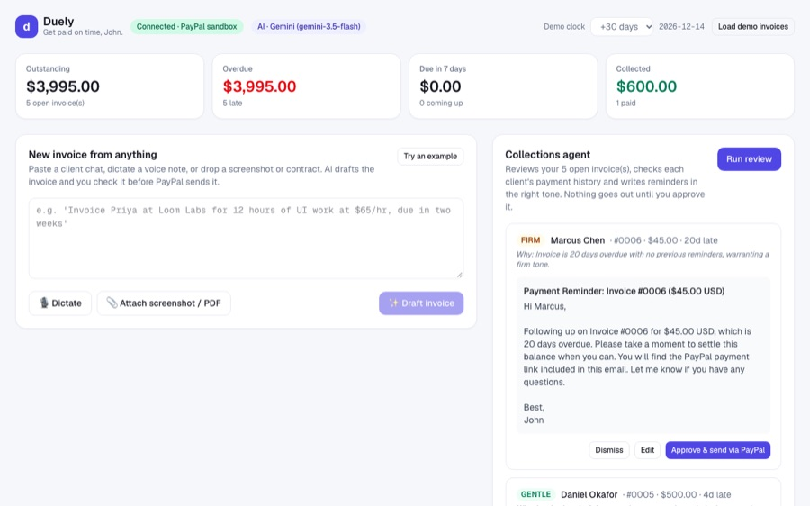</a> <b>Duely</b> · AI invoicing copilot</td>
    <td align="center" width="33%"><a href="https://shineyrbl-byte.github.io/saymath/">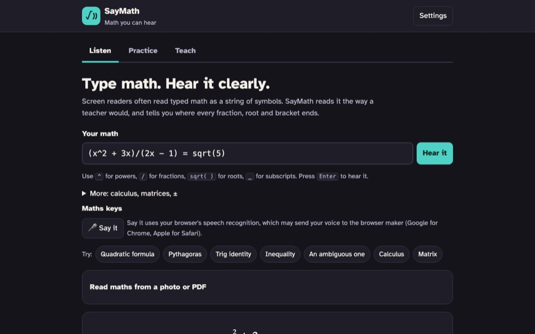</a> <b>SayMath</b> · math you can hear</td>
  </tr>
</table>

<b>More recent builds</b> (auto-updated)

<!-- LATEST-REPOS:START -->
- [**dont-mix**](https://github.com/shineyrbl-byte/dont-mix): Don't Mix: check cleaning products before you mix or store them together. Rule-based, offline, private. SafeSpace Hacks 2026. · JavaScript
- [**windowwise**](https://github.com/shineyrbl-byte/windowwise): Know when to open your windows: an hour-by-hour plan that cools your room for free and keeps polluted air out. · JavaScript
- [**natt**](https://github.com/shineyrbl-byte/natt): Natt ⚡ Lightning tontines (rotating savings groups) for West Africa, with a Nostr ledger and an AI helper. Dakar Bitcoin Hack 2026. · JavaScript
- [**scamshield**](https://github.com/shineyrbl-byte/scamshield): Paste a suspicious SMS, email or link and get a plain-language scam risk score. Next Byte Hacks V5. · JavaScript
- [**Gourd-intentions**](https://github.com/shineyrbl-byte/Gourd-intentions): 🎃 The to-do list where ignored tasks rot into pumpkins and come back as ghosts to roast you. · TypeScript
- [**Unreachable**](https://github.com/shineyrbl-byte/Unreachable): Unreachable: four people try to book a flu shot on a website that wasn't built for them. Feel the barriers, then fix them. · TypeScript
- [**Grandmas-phone**](https://github.com/shineyrbl-byte/Grandmas-phone): Grandma's Phone: a scam-spotting game for social good. Protect Grandma's savings without cutting her off from the people she loves. · TypeScript
- [**Codex-Twitch**](https://github.com/shineyrbl-byte/Codex-Twitch): StormChat: Twitch chat controls the weather on your stream. OBS overlay built with OpenAI Codex. · TypeScript
- [**dress-the-vibe**](https://github.com/shineyrbl-byte/dress-the-vibe): ✨ Dress the Vibe: tell us the vibe, and we pick the outfit, match the makeup to its colors, and put the whole look on you with YouCam AI Clothes + Makeup VTO. · TypeScript
- [**YouCam-API**](https://github.com/shineyrbl-byte/YouCam-API): ⚖️ Product on Trial: is your skincare actually working? YouCam Skin AI scans are the evidence, and the court rules Acquitted, Guilty or Case Continued. Built for the YouCam API Skin AI Hackathon. · TypeScript
- [**Renderjuice-Blender**](https://github.com/shineyrbl-byte/Renderjuice-Blender): Escape Velocity: a 16s fully procedural Blender animation about Speed. One Python script builds everything: Geometry Nodes, camera, HUD, sparks & a synthesized soundtrack. RenderJuice contest entry. · Python
- [**nebius-study-copilot**](https://github.com/shineyrbl-byte/nebius-study-copilot): Private, sandboxed personal AI for students: persistent memory, deadline tracking, daily briefs, and document-to-action-items. Runs NVIDIA Nemotron on Nebius Token Factory via NemoClaw/OpenShell. · Shell
- [**bee-amazon**](https://github.com/shineyrbl-byte/bee-amazon): Turn promises you speak into your Bee into tasks, draft follow-ups, and calendar events, using the Bee CLI and Claude on Amazon Bedrock. · Python
- [**shelflife**](https://github.com/shineyrbl-byte/shelflife): Expiry tracking and rescue bundles for small cafés and grocers · TypeScript
- [**founderpath**](https://github.com/shineyrbl-byte/founderpath): FounderPath: an AI co-founder that turns a raw idea into a validated plan, build roadmap and first users. Next Founders hackathon. · TypeScript
<!-- LATEST-REPOS:END -->

### `git log --recent`

<!-- RECENT-ACTIVITY:START -->
- 💪 Opened 1 PR ([#37](https://github.com/shineyrbl-byte/shelflife/pull/37)) in [shelflife](https://github.com/shineyrbl-byte/shelflife) · Nov 14
- 🔨 Pushed to [dataforge-rime](https://github.com/shineyrbl-byte/dataforge-rime) · Nov 14
- 🔨 Pushed to [Grandmas-phone](https://github.com/shineyrbl-byte/Grandmas-phone) · Nov 14
- 🎉 Merged 11 PRs ([#74](https://github.com/f20241463-cmd/CS-F407-chaturanga/pull/74), [#73](https://github.com/f20241463-cmd/CS-F407-chaturanga/pull/73), [#72](https://github.com/f20241463-cmd/CS-F407-chaturanga/pull/72), …) in [f20241463-cmd/CS-F407-chaturanga](https://github.com/f20241463-cmd/CS-F407-chaturanga) · Nov 14
- 🔨 Pushed to [seed-and-spread](https://github.com/shineyrbl-byte/seed-and-spread) · Nov 12
- 🔨 Pushed to [scar-tissue](https://github.com/shineyrbl-byte/scar-tissue) · Nov 11
<!-- RECENT-ACTIVITY:END -->

### `experience --list`

<b>3 internships</b>: MindPeers · Labmentix · Evoastra

- **MindPeers** · AI/ML & Software Development Intern  
  Developed a Flask-based, domain-focused LLM chatbot prototype with local Ollama/Qwen integration and safety-oriented crisis phrase handling. Also helped organise 500+ Homework Library resources into 375 files.
- **Labmentix** · Data Science with AI Intern  
  Built a React/Vite + FastAPI text summarizer using DistilBART, developed a Streamlit travel-agent prototype, and worked on PhonePe Pulse and Zomato data projects.
- **Evoastra** · Python / Data Analysis Intern  
  Worked with Pandas, NumPy, Matplotlib, and Seaborn for data cleaning, exploratory analysis, and visualisation.

### `cat ~/writing`

- 📄 [**Seed, Don't Spread**](https://github.com/shineyrbl-byte/seed-and-spread/blob/main/paper/writeup.md): what a small on-device model needs to see of a repository. Gemma 4 paper track on Kaggle.
- 🩹 [**Scar Tissue: turning postmortems into warnings**](https://github.com/shineyrbl-byte/scar-tissue/blob/main/docs/DEVPOST.md): the Codegeist 2026 project write-up.

### `github-stats`

<!-- THIS-MONTH:START -->

<b>📅 November 2026 so far:</b> 435 contributions · 26 repos · 53 PRs merged

<!-- THIS-MONTH:END -->

  <picture>
    <source media="(prefers-color-scheme: dark)" srcset="https://raw.githubusercontent.com/shineyrbl-byte/shineyrbl-byte/main/profile/stats.svg"/>
    <source media="(prefers-color-scheme: light)" srcset="https://raw.githubusercontent.com/shineyrbl-byte/shineyrbl-byte/main/profile/stats-light.svg"/>
    
  </picture>
  <picture>
    <source media="(prefers-color-scheme: dark)" srcset="https://raw.githubusercontent.com/shineyrbl-byte/shineyrbl-byte/main/profile/top-langs.svg"/>
    <source media="(prefers-color-scheme: light)" srcset="https://raw.githubusercontent.com/shineyrbl-byte/shineyrbl-byte/main/profile/top-langs-light.svg"/>
    
  </picture>

  <picture>
    <source media="(prefers-color-scheme: dark)" srcset="https://raw.githubusercontent.com/shineyrbl-byte/shineyrbl-byte/main/profile/streak.svg"/>
    <source media="(prefers-color-scheme: light)" srcset="https://raw.githubusercontent.com/shineyrbl-byte/shineyrbl-byte/main/profile/streak-light.svg"/>
    
  </picture>

<b>More graphs</b>: 30-day trend and 3D contribution calendar

  <picture>
    <source media="(prefers-color-scheme: dark)" srcset="https://raw.githubusercontent.com/shineyrbl-byte/shineyrbl-byte/main/profile/trend-dark.svg"/>
    <source media="(prefers-color-scheme: light)" srcset="https://raw.githubusercontent.com/shineyrbl-byte/shineyrbl-byte/main/profile/trend-light.svg"/>
    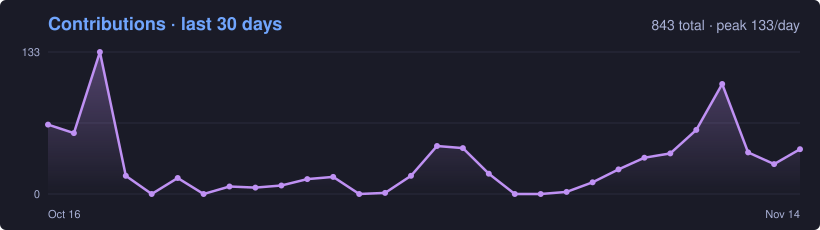
  </picture>

  <picture>
    <source media="(prefers-color-scheme: dark)" srcset="https://raw.githubusercontent.com/shineyrbl-byte/shineyrbl-byte/main/profile-3d-contrib/profile-night-rainbow.svg"/>
    <source media="(prefers-color-scheme: light)" srcset="https://raw.githubusercontent.com/shineyrbl-byte/shineyrbl-byte/main/profile-3d-contrib/profile-gitblock.svg"/>
    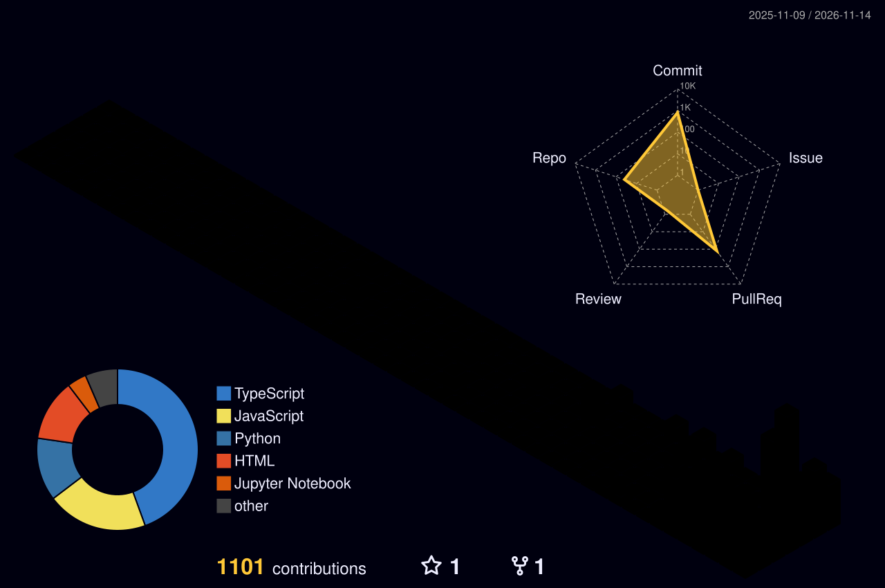
  </picture>

### `contribution-snake`

  <picture>
    <source media="(prefers-color-scheme: dark)" srcset="https://raw.githubusercontent.com/shineyrbl-byte/shineyrbl-byte/output/github-contribution-grid-snake-dark.svg"/>
    <source media="(prefers-color-scheme: light)" srcset="https://raw.githubusercontent.com/shineyrbl-byte/shineyrbl-byte/output/github-contribution-grid-snake.svg"/>
    
  </picture>

---

<i>Still learning. Still building. Always curious. ✨</i>

