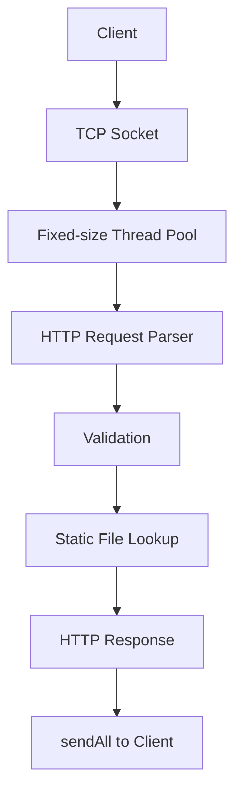
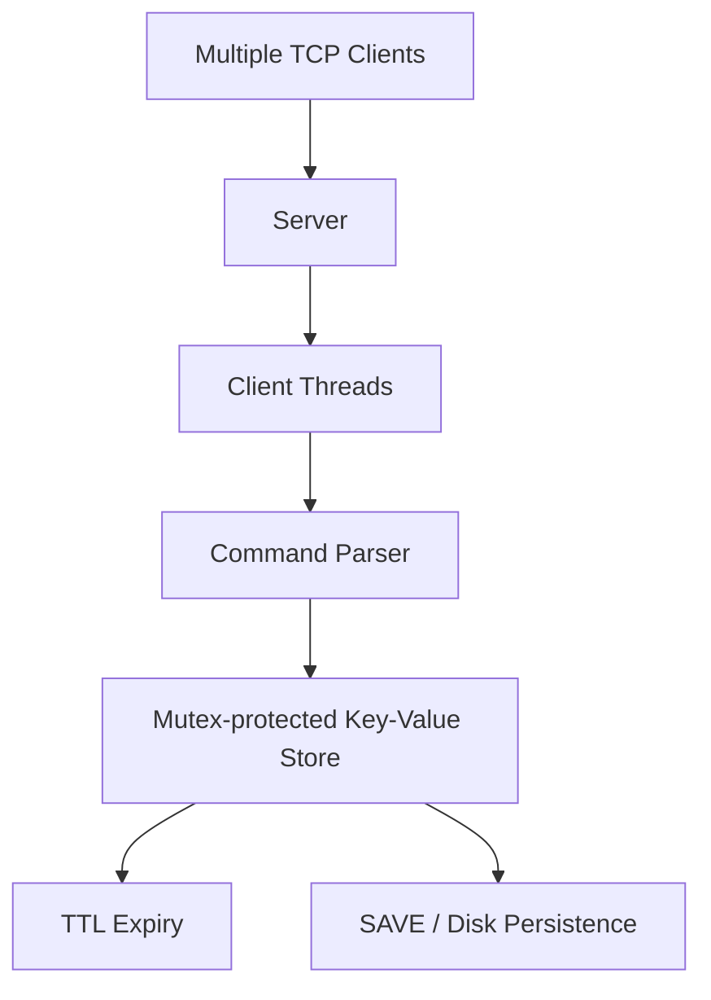

<!-- Profile README for github.com/shineyrbl-byte -->

  

<h1 align="center">Hi, I'm Avisha 👋</h1>

  <b>Software Engineering | C++ · Python · Backend & Systems</b> 
  BITS Pilani, Goa Campus · 2024–2028

  

  🚧 <b>Now building:</b> <a href="https://github.com/shineyrbl-byte/seed-and-spread">Seed &amp; Spread</a>: budgeted code-graph repo maps that help small on-device models (Gemma 4) find bugs

---

### `whoami`

I'm an undergraduate at **BITS Pilani, Goa Campus** who enjoys building software from the ground up and understanding how it works under the hood. My current focus is **C++ backend and systems programming**—networked servers, concurrency, and data structures—alongside Python-based applications.

- 🧩 Interested in C++, DSA, backend engineering, and core computer science
- 🔧 I enjoy building practical projects, from TCP servers to developer tools
- 🏁 I ship fast at hackathons: 20+ builds in Oct–Nov 2026 alone, from AR lenses to quantum compilers
- 🌱 Currently building C++ systems projects, practising DSA, and strengthening my foundations in OS, computer networks, DBMS, and system design

### `skills --list`

  

| Area | Tools & concepts |
|---|---|
| **Languages** | C++, Python, TypeScript, JavaScript, Kotlin, SQL |
| **Core CS** | Data Structures & Algorithms, OOP, DBMS |
| **Backend & Systems** | POSIX sockets, TCP/IP, HTTP/1.1, multithreading, Flask, FastAPI, CMake |
| **Web** | React, Next.js, Node.js, HTML, CSS |
| **Tools** | Git, GitHub, Docker, VS Code |

### `ls ~/featured-projects`

| Project | What I built | Stack |
|---|---|---|
| [**TitanHTTP**](https://github.com/shineyrbl-byte/TitanHTTP) | HTTP/1.1 server built from scratch with POSIX sockets, request parsing, static-file serving, error handling, and a fixed-size worker thread pool. Tested with curl, netcat, and concurrent clients. | C++, POSIX sockets, threads |
| [**Mini Redis**](https://github.com/shineyrbl-byte/mini-redis) | Multithreaded TCP key-value store with Redis-style commands, lazy TTL expiry, mutex-protected storage, and disk persistence. Local PING benchmarks in the project README report ~62.3K req/s sequentially and ~107.8K req/s across 10 clients. | C++17, TCP, mutexes, file I/O |
| [**Last-Minute Life Saver**](https://github.com/shineyrbl-byte/last-minute-life-saver) | Student productivity planner with a C++ REST backend, task-priority and risk-analysis logic, Gemini-powered study plans, and productivity analytics. | C++, React, CMake, Gemini API |
| [**RSA Security Lab**](https://github.com/shineyrbl-byte/rsa-security-project) | Interactive project exploring RSA key generation, encryption/decryption, and selected attacks on deliberately weak or controlled examples. | C++, cryptography |
| [**Mini DBMS**](https://github.com/shineyrbl-byte/mini-dbms) *(in progress)* | Relational database engine from scratch: typed columns, schemas, and tables that validate rows on insert. Next up: storage, indexing, and a query layer. | C++, CMake |
| [**AI Text Summarizer**](https://github.com/shineyrbl-byte/AI-Text-Summarizer) | React and FastAPI application that summarizes text and uploaded PDFs using a Hugging Face DistilBART model. | Python, FastAPI, React, Transformers |

<b>Systems project architecture previews</b>

**TitanHTTP**

**Mini Redis**

### `hackathons --recent`

| Project | What it does | Event | Links |
|---|---|---|---|
| [**Distributed Quantum Compiler**](https://github.com/shineyrbl-byte/qff_bits_TEAM-N5CM52) | Splits Qiskit circuits across linked QPUs with teleportation, gate packing, and wire cutting, plus a resource-aware scheduler. Verified on real IBM quantum hardware. | QFF 2026 | [repo](https://github.com/shineyrbl-byte/qff_bits_TEAM-N5CM52) |
| [**Seed & Spread**](https://github.com/shineyrbl-byte/seed-and-spread) | Issue-seeded code-graph repo maps that help small on-device models (Gemma 4) localize bugs. | Gemma 4 Paper Track | [repo](https://github.com/shineyrbl-byte/seed-and-spread) |
| [**Scar Tissue**](https://github.com/shineyrbl-byte/scar-tissue) | Forge app + Rovo agent that turns forgotten postmortems into just-in-time warnings on Jira issues. | Codegeist 2026 | [demo](https://youtu.be/YXnuIGSu_dk) |
| [**Duely**](https://github.com/shineyrbl-byte/duely) | AI get-paid copilot for freelancers: turns messy chats into PayPal invoices and chases late payments with an approval-first agent. | PayPal AI Hackathon | [live](https://duely-ten-iota.vercel.app) · [demo](https://youtu.be/fmJgOGCpJZk) |
| [**Moss & Moon**](https://github.com/shineyrbl-byte/moss-and-moon) | Full café platform: drink builder, group orders, payments, accounts, AI barista, and a staff dashboard with analytics. | Personal build | [live](https://moss-and-moon.up.railway.app) |
| [**SayMath**](https://github.com/shineyrbl-byte/saymath) | Turns typed equations into clear, explorable speech in English and Hindi. Works offline. | AccessED Hacks 2026 | [live](https://shineyrbl-byte.github.io/saymath/) · [demo](https://youtu.be/OQ8i_HQ8HNc) |
| [**Lab Logger**](https://github.com/shineyrbl-byte/lab-logger) | AR Lens for Snap Spectacles that logs lab bench sensor readings into a floating table and live graphs. | Learn AR with SPECS | [demo](https://youtu.be/4U_Zpr5aqFk) |

<b>All recent hackathon builds</b>

- [**Natt**](https://github.com/shineyrbl-byte/natt): Lightning tontines (rotating savings groups) with a Nostr ledger. *Dakar Bitcoin Hack 2026*
- [**ScamShield**](https://github.com/shineyrbl-byte/scamshield): plain-language scam risk scores for SMS, email, and links. *Next Byte Hacks V5*
- [**Don't Mix**](https://github.com/shineyrbl-byte/dont-mix): offline check for unsafe cleaning-product combinations. *SafeSpace Hacks 2026*
- [**WindowWise**](https://github.com/shineyrbl-byte/windowwise): hour-by-hour plan for when to open your windows
- [**Grandma's Phone**](https://github.com/shineyrbl-byte/Grandmas-phone): scam-spotting game for social good
- [**Unreachable**](https://github.com/shineyrbl-byte/Unreachable): an accessibility empathy simulator
- [**Gourd Intentions**](https://github.com/shineyrbl-byte/Gourd-intentions): a to-do list where ignored tasks rot into pumpkins
- [**StormChat**](https://github.com/shineyrbl-byte/Codex-Twitch): Twitch chat controls the weather on your stream (built with OpenAI Codex)
- [**Dress the Vibe**](https://github.com/shineyrbl-byte/dress-the-vibe) and [**Product on Trial**](https://github.com/shineyrbl-byte/YouCam-API): YouCam AI hackathon entries
- [**Escape Velocity**](https://github.com/shineyrbl-byte/Renderjuice-Blender): fully procedural Blender animation from one Python script. *RenderJuice*
- [**Study Copilot**](https://github.com/shineyrbl-byte/nebius-study-copilot): sandboxed student AI on NVIDIA Nemotron + Nebius
- [**Bee Promises**](https://github.com/shineyrbl-byte/bee-amazon): spoken promises → tasks and calendar events with Claude on Amazon Bedrock
- [**ShelfLife**](https://github.com/shineyrbl-byte/shelflife): expiry tracking and rescue bundles for small cafés
- [**FounderPath**](https://github.com/shineyrbl-byte/founderpath): AI co-founder from raw idea to validated plan. *Next Founders*
- [**ClaimTrace**](https://github.com/shineyrbl-byte/claimtrace): evidence-backed search agent. *SerpApi Hackathon*

### `experience --list`

- **MindPeers** · AI/ML & Software Development Intern  
  Developed a Flask-based, domain-focused LLM chatbot prototype with local Ollama/Qwen integration and safety-oriented crisis phrase handling. Also helped organise 500+ Homework Library resources into 375 files.
- **Labmentix** · Data Science with AI Intern  
  Built a React/Vite + FastAPI text summarizer using DistilBART, developed a Streamlit travel-agent prototype, and worked on PhonePe Pulse and Zomato data projects.
- **Evoastra** · Python / Data Analysis Intern  
  Worked with Pandas, NumPy, Matplotlib, and Seaborn for data cleaning, exploratory analysis, and visualisation.

### `github-stats`

  
  

  

### `contribution-snake`

  <picture>
    <source media="(prefers-color-scheme: dark)" srcset="https://raw.githubusercontent.com/shineyrbl-byte/shineyrbl-byte/output/github-contribution-grid-snake-dark.svg"/>
    <source media="(prefers-color-scheme: light)" srcset="https://raw.githubusercontent.com/shineyrbl-byte/shineyrbl-byte/output/github-contribution-grid-snake.svg"/>
    
  </picture>

---

<i>Still learning. Still building. Always curious. ✨</i>

