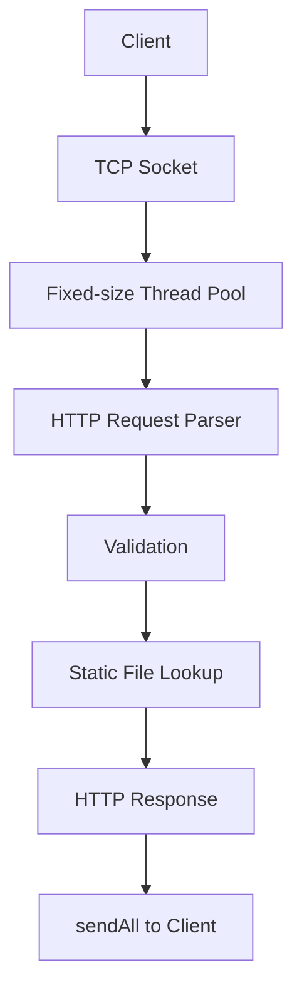
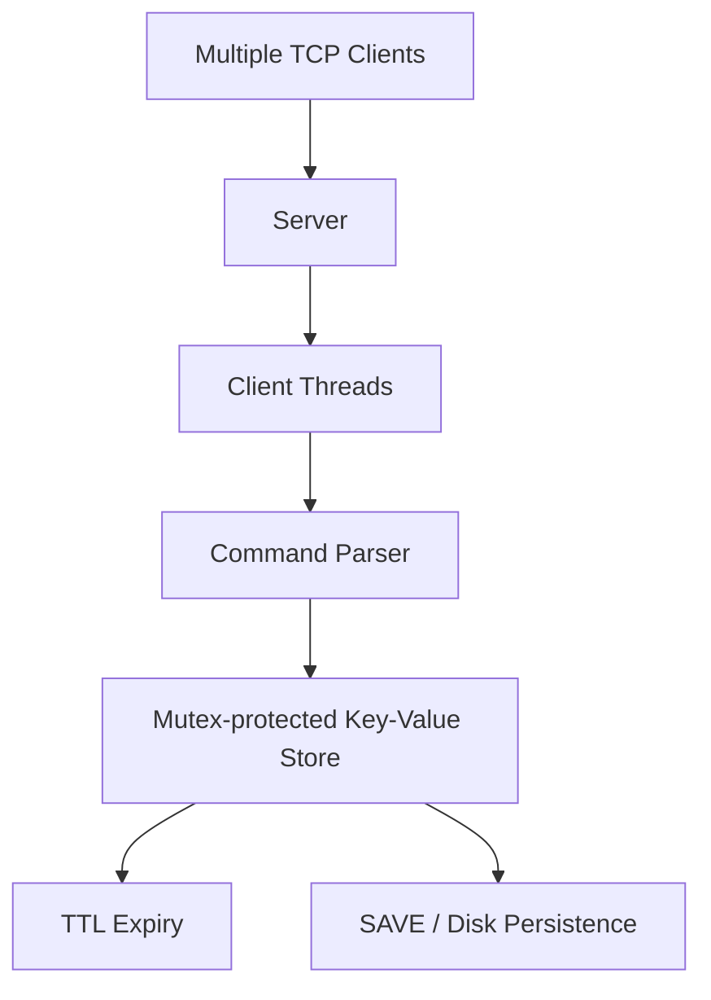

<!-- Profile README for github.com/shineyrbl-byte -->

  

<h1 align="center">Hi, I'm Avisha 👋</h1>

  <b>Software Engineering | C++ · Python · Backend & Systems</b> 
  BITS Pilani, Goa Campus · 2024–2028

  
  

---

### `whoami`

I'm an undergraduate at **BITS Pilani, Goa Campus** who enjoys building software from the ground up and understanding how it works under the hood. My current focus is **C++ backend and systems programming**—networked servers, concurrency, and data structures—alongside Python-based applications.

- 🧩 Interested in C++, DSA, backend engineering, and core computer science
- 🔧 I enjoy building practical projects, from TCP servers to developer tools
- 🌱 Currently strengthening my foundations in operating systems, computer networks, DBMS, and system design

### `skills --list`

  

| Area | Tools & concepts |
|---|---|
| **Languages** | C++, Python, SQL |
| **Core CS** | Data Structures & Algorithms, OOP, DBMS |
| **Backend & Systems** | POSIX sockets, TCP/IP, HTTP/1.1, multithreading, Flask, FastAPI, CMake |
| **Web** | React, HTML, CSS |
| **Tools** | Git, GitHub, Docker, VS Code |

### `ls ~/featured-projects`

| Project | What I built | Stack |
|---|---|---|
| [**TitanHTTP**](https://github.com/shineyrbl-byte/TitanHTTP) | HTTP/1.1 server built from scratch with POSIX sockets, request parsing, static-file serving, error handling, and a fixed-size worker thread pool. Tested with curl, netcat, and concurrent clients. | C++, POSIX sockets, threads |
| [**Mini Redis**](https://github.com/shineyrbl-byte/mini-redis) | Multithreaded TCP key-value store with Redis-style commands, lazy TTL expiry, mutex-protected storage, and disk persistence. Local PING benchmarks in the project README report ~62.3K req/s sequentially and ~107.8K req/s across 10 clients. | C++17, TCP, mutexes, file I/O |
| [**Last-Minute Life Saver**](https://github.com/shineyrbl-byte/last-minute-life-saver) | Student productivity planner with a C++ REST backend, task-priority and risk-analysis logic, Gemini-powered study plans, and productivity analytics. | C++, React, CMake, Gemini API |
| [**RSA Security Lab**](https://github.com/shineyrbl-byte/rsa-security-project) | Interactive project exploring RSA key generation, encryption/decryption, and selected attacks on deliberately weak or controlled examples. | C++, cryptography |
| [**AI Text Summarizer**](https://github.com/shineyrbl-byte/AI-Text-Summarizer) | React and FastAPI application that summarizes text and uploaded PDFs using a Hugging Face DistilBART model. | Python, FastAPI, React, Transformers |

<b>Systems project architecture previews</b>

**TitanHTTP**

**Mini Redis**

### `experience --list`

- **MindPeers** · AI/ML & Software Development Intern  
  Developed a Flask-based, domain-focused LLM chatbot prototype with local Ollama/Qwen integration and safety-oriented crisis phrase handling. Also helped organise 500+ Homework Library resources into 375 files.
- **Labmentix** · Data Science with AI Intern  
  Built a React/Vite + FastAPI text summarizer using DistilBART, developed a Streamlit travel-agent prototype, and worked on PhonePe Pulse and Zomato data projects.
- **Evoastra** · Python / Data Analysis Intern  
  Worked with Pandas, NumPy, Matplotlib, and Seaborn for data cleaning, exploratory analysis, and visualisation.

### `currently`

Building C++ backend/systems projects · Practising DSA · Learning OS, CN, DBMS & System Design

### `github-stats`

  
  

  

### `connect`

  <a href="https://github.com/shineyrbl-byte">GitHub · shineyrbl-byte</a>
  &nbsp;·&nbsp;
  <a href="https://www.linkedin.com/in/avisha-srivastava-a7b78523a/">LinkedIn · Avisha Srivastava</a>

### `contribution-snake`

  <picture>
    <source media="(prefers-color-scheme: dark)" srcset="https://raw.githubusercontent.com/shineyrbl-byte/shineyrbl-byte/output/github-contribution-grid-snake-dark.svg"/>
    <source media="(prefers-color-scheme: light)" srcset="https://raw.githubusercontent.com/shineyrbl-byte/shineyrbl-byte/output/github-contribution-grid-snake.svg"/>
    
  </picture>

---

<i>Still learning. Still building. Always curious. ✨</i>

